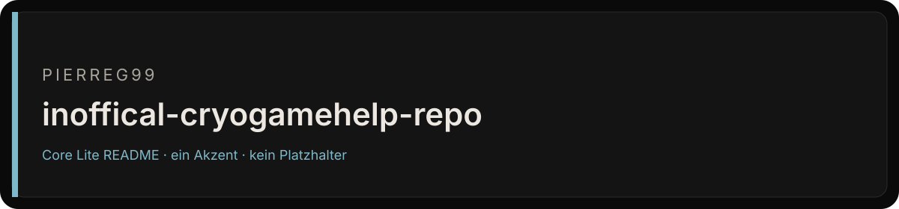

<div align="center">


# CRYOGAMEHELP
**Independent guides, teams, decks and strategies for mobile games**

[Open website](https://pierreg99.github.io/inoffical-cryogamehelp-repo/) · [Omega Review Lab](https://pierreg99.github.io/inoffical-cryogamehelp-repo/omega-lab.html) · [Website documentation](docs/README.md) · [Vision 3.0 roadmap](docs/VISION3_ROADMAP.md)

[](https://github.com/Pierreg99/inoffical-cryogamehelp-repo/actions/workflows/pages.yml)
</div>

## Four supported games

| Game | Features |
| --- | --- |
| **Dragon Ball Legends** | PvP guides, 3 battle + 3 bench strategy planning, manually entered team notes |
| **Pokémon TCG Pocket** | 20-card deck planning and versioned validated deck JSON import/export |
| **Pokémon TCG Live** | 60-card deck planning, simplified copy limits and versioned JSON import/export |
| **Pokémon GO** | Raid-team and progression planning |

The main website provides **English, German and French**, eight editorial guides, browser-local bookmarks and independently tracked self-reported guide progress. No account, paid API, or verified live-meta feed is required.

## Omega Build Review Lab (experimental)

An optional **German-only** standalone workspace with four profiles, structural validation hints, original Precision-Neon UI, accessible input controls and JSON export. **It does not share local plans automatically with the main planner**, provide current rankings, or verify competitive game legality. [Details](docs/OMEGA_REVIEW.md).

## Local development

Requirements: Node.js 22+ and npm.

```sh
npm ci
npm start
# Open http://localhost:4173
npm run check
npx playwright install chromium
npm test
```

GitHub Actions runs desktop/mobile browser tests before Pages publication. Review the [current workflow results](https://github.com/Pierreg99/inoffical-cryogamehelp-repo/actions) rather than assuming a permanent pass.

## Repository navigation

- [Production web app](docs/) — site, local planners, languages, optional Omega Lab
- [Dragon Ball Legends](DB_Legends/) — guides and strategy notes
- [Game modules](GAMES/) — Pokémon TCG Pocket, Live and GO
- [Tests](tests/) — browser regressions, layout and Omega Lab checks
- [Publisher imagery sources](docs/assets/sources.json) — image credits and licensing context

**Evidence policy:** Strategy guidance is editorial, not an official tier ranking. Card printings, game mechanics, patches and synergy need independently checked current sources.

## Rights

Unofficial fan project, not affiliated with the publishers. Dragon Ball and Pokémon game names, images, logos and screenshots belong to their respective rights holders. The [MIT license](LICENSE.md) does not relicense third-party game assets. Consult [image credits](docs/assets/README.md).
